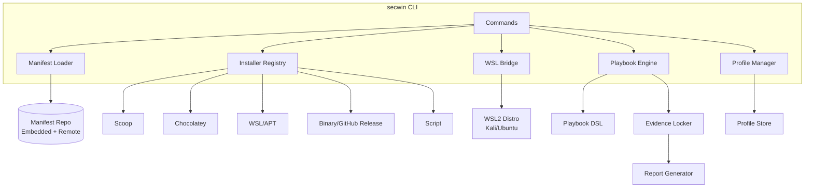

# SecWin — Modern Kali Tooling on Windows

> A unified, opinionated security toolchain for Windows pentesters. Install, orchestrate, and report — all native.

[](https://github.com/secwin/secwin/actions)
[](https://github.com/secwin/secwin/releases)
[](https://go.dev)
[](LICENSE)

## Why SecWin?

| Pain Point | SecWin Solution |
|------------|-----------------|
| Tools scattered across Scoop, Choco, WSL, GitHub, manual installs | **Single CLI**: `secwin install nmap nuclei burp ghidra` |
| WSL path translation, distro management, tool version drift | **WSL Bridge**: Auto-provisions Kali, mounts shares, translates paths |
| No unified engagement workflow — copy-paste commands between tools | **Playbooks**: YAML DSL for recon → enum → exploit → report |
| OpSec profile switching (VPN, MAC, hostname) is manual | **Profiles**: `secwin profile engage client-a` isolates everything |
| Reporting = screenshots + manual markdown | **Evidence Locker**: Auto-collects artifacts, generates ATT&CK-mapped reports |

## Quick Start

```powershell
# Install SecWin (via Scoop)
scoop bucket add secwin https://github.com/secwin/secwin-bucket
scoop install secwin

# Or download binary from Releases

# Install core toolset
secwin install @core          # 50+ curated tools
secwin install nmap nuclei    # Individual tools

# Run tools natively (Windows) or via WSL (Linux-only)
secwin run nmap -sS 10.0.0.1
secwin wsl run bloodhound -d domain.local -u user -p pass

# Launch a playbook
secwin playbook run external-recon --target example.com --output ./engagement

# Manage OpSec profiles
secwin profile create client-a --vpn wireguard/client-a.conf --mac-spoof
secwin profile engage client-a
```

## Architecture



## Tool Coverage (MVP: 50+)

| Category | Tools |
|----------|-------|
| **Recon** | nmap, masscan, nuclei, ffuf, gobuster, subfinder, amass, httpx, naabu |
| **Exploitation** | metasploit, sqlmap, crackmapexec, impacket, responder, bettercap |
| **Post-Exploit** | bloodhound, sharphound, seatbelt, winpeas, linpeas, mimikatz |
| **Reverse** | ghidra, radare2, cutter, dnspy, ilspy, strings, yara |
| **Wireless** | aircrack-ng, wifite, kismet, besside-ng |
| **Forensics** | volatility, autopsy, plaso, kape, hayabusa |
| **Crypto** | hashcat, john, hydra, medusa, crowbar |
| **Web** | burp, zap, wfuzz, dalfox, xsstrike, arjun |
| **Cloud** | prowler, scoutsuite, cloudfox, pacu |
| **Reporting** | dradis, faraday, custom markdown/HTML/PDF |

## Playbook Example

```yaml
# external-recon.yaml
metadata:
  name: external-recon
  version: "1.0"
  description: "Full external reconnaissance pipeline"
  mitre_tactics: ["TA0043"]  # Reconnaissance

variables:
  target:
    type: string
    required: true
  output_dir:
    type: string
    default: "./engagement/{{.target}}"
  rate_limit:
    type: int
    default: 1000

steps:
  - id: subdomain_enum
    name: "Subdomain Enumeration"
    tool: subfinder
    args: ["-d", "{{.target}}", "-o", "{{.output_dir}}/subdomains.txt", "-silent"]
    artifacts: ["{{.output_dir}}/subdomains.txt"]
    mitre_techniques: ["T1590.005"]

  - id: port_scan
    name: "Port Scan Top 1000"
    tool: naabu
    args: ["-list", "{{.output_dir}}/subdomains.txt", "-top-ports", "1000", "-rate", "{{.rate_limit}}", "-o", "{{.output_dir}}/ports.txt"]
    artifacts: ["{{.output_dir}}/ports.txt"]
    mitre_techniques: ["T1595.001"]

  - id: service_detect
    name: "Service Detection"
    tool: nmap
    args: ["-iL", "{{.output_dir}}/ports.txt", "-sV", "-sC", "-oA", "{{.output_dir}}/services"]
    artifacts: ["{{.output_dir}}/services.*"]
    mitre_techniques: ["T1595.002"]

  - id: tech_fingerprint
    name: "Technology Fingerprinting"
    tool: nuclei
    args: ["-l", "{{.output_dir}}/subdomains.txt", "-t", "technologies/", "-o", "{{.output_dir}}/tech.json", "-json"]
    artifacts: ["{{.output_dir}}/tech.json"]
    mitre_techniques: ["T1590.001"]

  - id: screenshot
    name: "HTTP Screenshots"
    tool: httpx
    args: ["-l", "{{.output_dir}}/subdomains.txt", "-screenshot", "-store-response", "-o", "{{.output_dir}}/http.txt"]
    artifacts: ["{{.output_dir}}/screenshots/*"]
    mitre_techniques: ["T1590.001"]

outputs:
  findings: "{{.output_dir}}/findings.json"
  report: "{{.output_dir}}/report.html"
  evidence_dir: "{{.output_dir}}"
```

## Project Structure

```
secwin/
├── cmd/secwin/           # CLI entry point
├── internal/
│   ├── manifest/         # Tool manifest types + loader
│   ├── installer/        # Installer implementations
│   ├── wsl/              # WSL2 bridge
│   ├── playbook/         # Playbook parser + executor
│   ├── profile/          # OpSec profile manager
│   ├── config/           # Configuration
│   ├── evidence/         # Evidence locker
│   └── report/           # Report generator
├── manifests/            # Embedded tool manifests (50+)
├── playbooks/            # Built-in playbooks
├── docs/                 # Documentation
└── .github/workflows/    # CI/CD
```

## Documentation

- [Architecture](docs/ARCHITECTURE.md)
- [Adding Tools](docs/MANIFEST_GUIDE.md)
- [Playbook DSL](docs/PLAYBOOK_GUIDE.md)
- [OpSec Profiles](docs/OPSEC_GUIDE.md)
- [Contributing](CONTRIBUTING.md)

## Ethics & Legal

**SecWin is a tool orchestration framework.** It installs and runs existing security tools — it adds no offensive capability. Users are responsible for:

- Operating only within authorized scope
- Complying with local laws (CFAA, CMA, etc.)
- Respecting tool licenses (GPL, MIT, proprietary)
- Reporting vulnerabilities responsibly

See [ETHICS.md](ETHICS.md) for full policy.

## License

MIT — see [LICENSE](LICENSE). Tool manifests reference upstream licenses.