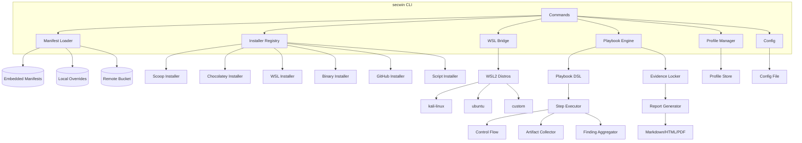

# SecWin Architecture

## Overview

SecWin is a modular security toolchain for Windows. Its architecture emphasizes:

- **Separation of concerns**: CLI, manifests, installers, playbooks, WSL bridge are independent packages
- **Extensibility**: New tools, installers, and playbook steps plug in via interfaces
- **OpSec by design**: Profiles isolate engagement state; evidence locker tracks artifacts
- **Cross-platform**: Native Windows binaries + WSL2 for Linux-only tools

## Component Diagram



## Data Flow

```
User Command
     │
     ▼
┌─────────────────┐
│   CLI Parser    │  (Cobra)
└────────┬────────┘
         │
         ▼
┌─────────────────┐
│  Config Load    │  (Viper: YAML + env + flags)
└────────┬────────┘
         │
         ▼
┌─────────────────┐     ┌──────────────────┐
│ Manifest Loader │────▶│ ToolManifest[]   │  (Embedded + Local + Remote)
└────────┬────────┘     └──────────────────┘
         │
         ▼
┌─────────────────┐     ┌──────────────────┐
│ Installer Reg.  │────▶│ Installer[]      │  (Scoop, Choco, WSL, Binary, GitHub, Script)
└────────┬────────┘     └──────────────────┘
         │
         ▼
┌─────────────────┐
│   Execution     │  (Native binary OR WSL bridge)
└────────┬────────┘
         │
         ▼
┌─────────────────┐     ┌──────────────────┐
│ Evidence Locker │────▶│ Artifacts/Findings│
└────────┬────────┘     └──────────────────┘
         │
         ▼
┌─────────────────┐
│ Report Generator│  (Templates → Markdown/HTML/PDF)
└─────────────────┘
```

## Package Structure

```
github.com/secwin/secwin/
├── cmd/secwin/                 # CLI entry point
│   ├── main.go                 # Root command, version
│   └── commands/               # Subcommands
│       ├── install.go          # Tool installation
│       ├── run.go              # Tool execution
│       ├── update.go           # Tool updates
│       ├── list.go             # Tool listing
│       ├── search.go           # Tool search
│       ├── wsl.go              # WSL management
│       ├── playbook.go         # Playbook operations
│       ├── config.go           # Configuration
│       ├── profile.go          # OpSec profiles
│       └── manifest.go         # Manifest management
├── internal/
│   ├── manifest/               # Tool manifests
│   │   ├── types.go            # ToolManifest, InstallMethodEntry
│   │   └── loader.go           # Embedded + local + remote loading
│   ├── installer/              # Installation backends
│   │   ├── installer.go        # Interface + registry + helpers
│   │   ├── scoop.go            # Scoop backend
│   │   ├── chocolatey.go       # Chocolatey backend
│   │   ├── wsl.go              # WSL/APT backend
│   │   ├── binary.go           # GitHub releases / direct downloads
│   │   ├── github.go           # Git clone + build
│   │   └── script.go           # PowerShell/Bash scripts
│   ├── wsl/                    # WSL2 bridge
│   │   └── manager.go          # Distro mgmt, command exec, file sync
│   ├── playbook/               # Playbook engine
│   │   ├── types.go            # Playbook, Step, Variable, Finding
│   │   └── executor.go         # Execution, control flow, templating
│   ├── config/                 # Configuration
│   │   └── config.go           # Viper-based config + profiles
│   ├── evidence/               # Evidence locker (planned)
│   └── report/                 # Report generation (planned)
├── manifests/                  # Embedded tool manifests (YAML)
├── playbooks/                  # Built-in playbooks (YAML)
├── docs/                       # Documentation
└── .github/workflows/          # CI/CD
```

## Key Interfaces

### Installer

```go
type Installer interface {
    Name() string
    Install(ctx context.Context, tm *manifest.ToolManifest, im *manifest.InstallMethodEntry) error
    Uninstall(ctx context.Context, tm *manifest.ToolManifest) error
    Update(ctx context.Context, tm *manifest.ToolManifest, im *manifest.InstallMethodEntry) error
    IsAvailable(ctx context.Context) bool
    GetInstalledVersion(ctx context.Context, tm *manifest.ToolManifest) (string, error)
}
```

### Manifest Loader

```go
type Loader struct {
    Get(name string) (*ToolManifest, bool)
    GetByAlias(alias string) (*ToolManifest, bool)
    List(category string) []*ToolManifest
    Search(query string) []*ToolManifest
    ValidateAll() []error
    ExportIndex(path string) error
}
```

### Playbook Executor

```go
type Executor struct {
    Execute(vars map[string]interface{}) *PlaybookResult
}
```

## Extension Points

| Extension | How |
|-----------|-----|
| **New tool** | Add YAML to `manifests/` or local override dir |
| **New installer** | Implement `Installer` interface, register in `main.go` |
| **New playbook step type** | Add to `Step` struct, handle in `executor.go` |
| **New output format** | Implement in `report/` package |
| **New OpSec action** | Extend `Profile` struct, handle in `profile.go` |

## Security Model

- **No elevated privileges required**: Installs to user directory (`~/.secwin`)
- **Tool verification**: SHA256 checksums for all binary installs
- **Profile isolation**: VPN, MAC, hostname, timezone per engagement
- **Evidence integrity**: Hashes recorded for all artifacts
- **No telemetry**: Zero network calls unless user runs tools that make them

## Performance Considerations

- **Manifest loading**: Embedded manifests load instantly; remote bucket cached
- **Parallel installation**: Independent tools install concurrently
- **WSL caching**: Distro startup cached; commands reuse session
- **Playbook parallelism**: `parallel:` blocks execute concurrently
- **Binary caching**: Downloaded archives cached in `~/.secwin/cache`

## Future Architecture (v1.1+)

```
┌─────────────────┐
│  Plugin System  │  (Go plugins or WASM for installers/steps)
└────────┬────────┘
         │
         ▼
┌─────────────────┐     ┌──────────────────┐
│  Remote State   │────▶│  etcd/Consul     │  (Multi-host engagements)
└────────┬────────┘     └──────────────────┘
         │
         ▼
┌─────────────────┐
│  AI Assistant   │  (Local LLM via Ollama for triage/suggestions)
└─────────────────┘
```